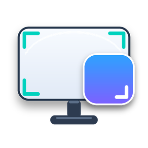
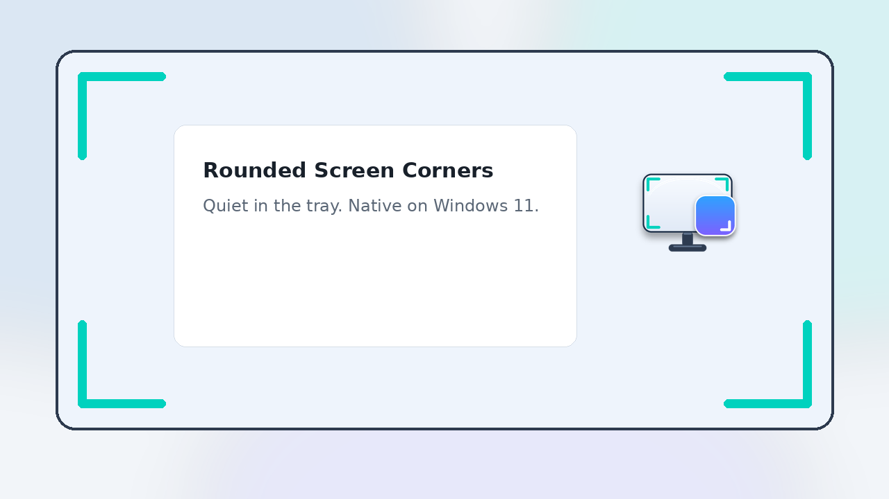
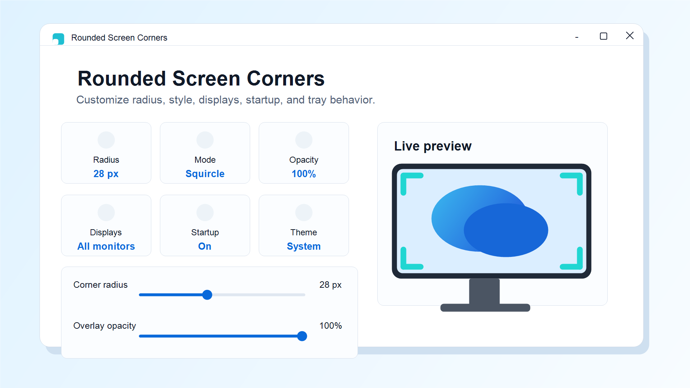
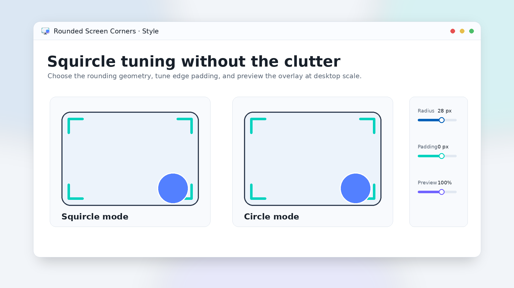
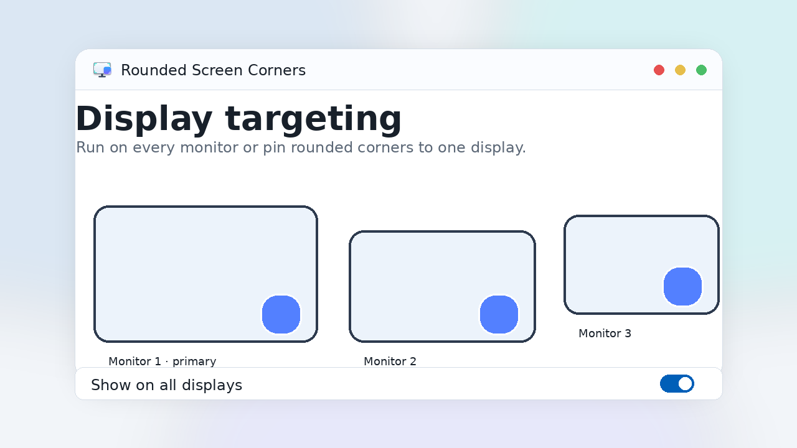

<p align="center">
  
</p>

<h1 align="center">Rounded Screen Corners</h1>

<p align="center">
  <a href="https://apps.microsoft.com/detail/9N9XMSJZDTSC?referrer=appbadge&cid=GitHub_README&mode=direct">
    
  </a>
</p>

<p align="center">
  <a href="https://github.com/jihedkdiss/RoundedScreenCorners/releases/latest"></a>
  <a href="https://apps.microsoft.com/detail/9N9XMSJZDTSC"></a>
  <a href="LICENSE"></a>
  <a href="https://github.com/jihedkdiss/RoundedScreenCorners/stargazers"></a>
  <a href="https://jihedkdiss.github.io/RoundedScreenCorners/"></a>
</p>

Rounded Screen Corners is a lightweight Windows utility that adds customizable rounded corner overlays to your displays. Built with **WinUI 3** and **.NET 8**, the UI blends in with Windows 11 and stays out of your way until you need it.

## Features ✨
- **Custom rounded overlays** — soften the corners of your screens with configurable overlays
- **Multiple rounding modes** — tune the style and behavior for your setup
- **Per-corner settings** — control which corners are rounded
- **Multi-monitor support** — apply overlays across your displays
- **System tray** — quick access without keeping the settings window open
- **Launch at startup** — optional automatic startup
- **Native Windows-like design** — WinUI 3 with light/dark theme support

## Screenshots 🖼️

<p align="center">
  
</p>

<table>
  <tr>
    <td width="50%" align="center">
      
      <sub><b>Home</b> — radius, opacity, display targeting, startup, and theme at a glance.</sub>
    </td>
    <td width="50%" align="center">
      
      <sub><b>Corners</b> — tune radius, style, color, opacity, and active corners in native WinUI 3.</sub>
    </td>
  </tr>
  <tr>
    <td width="50%" align="center">
      
      <sub><b>Settings</b> — startup, tray behavior, theme, reset, and exit controls.</sub>
    </td>
    <td width="50%" align="center">
      
      <sub><b>Preview</b> — clean Store-ready artwork showing the overlay concept.</sub>
    </td>
  </tr>
</table>

More at <https://jihedkdiss.github.io/RoundedScreenCorners/#screenshots>.

## How to install 📥
### Which version should you choose?
The **Microsoft Store version** provides automatic updates and one-click installation as a one-time purchase that supports development.
The **GitHub version** is completely free, fully featured, and open-source — but requires manual updates.
Read more in the [Sustainability & The Microsoft Store](#sustainability--the-microsoft-store-) section below.

### Using Microsoft Store
<p align="center">
  <a href="https://apps.microsoft.com/detail/9N9XMSJZDTSC?referrer=appbadge&cid=GitHub_README_2&mode=direct">
    
  </a>
</p>

### Using the GitHub installer
1. Go to the [latest release](https://github.com/jihedkdiss/RoundedScreenCorners/releases/latest) page
2. Download **`RoundedScreenCorners_<version>_x64_Installer.zip`**
3. Extract the archive
4. Run **`RoundedScreenCorners_Installer.bat`** — it installs the signing certificate to *Trusted Root* (Admin prompt) and runs the App Installer for the bundled `.msixbundle`

Prefer to do it by hand? Open `SystemFiles\` inside the extracted zip:
1. Double-click the **`*.cer`** file *(real certificates cost money)* and press **"Install Certificate..."**
2. On the Certificate Import Wizard, select **"Local Machine"**, press **"Next"** and grant Admin Access
3. Select **"Place all certificates in the following store"**, then **"Browse..."**, choose **"Trusted Root Certification Authorities"** and **"OK"**
4. Press **"Next"** and then **"Finish"**. Confirm if prompted
5. Double-click the **`*.msixbundle`** file — the App Installer will pop up; press **"Install"** (or **"Update"** if you've installed Rounded Screen Corners before)

## Requirements
- Windows 10 version 1809 (build 17763) or later
- Bundled `Microsoft.WindowsAppSDK` runtime (no separate install needed when using the Store / MSIX installers)
- For unpackaged dev builds: [.NET 8 Desktop Runtime](https://dotnet.microsoft.com/download/dotnet/8.0)

## Build
```
dotnet build RoundedScreenCorners/RoundedScreenCorners.csproj /p:Platform=x64
```

For local development without packaging, build and launch the produced executable from `RoundedScreenCorners/bin/x64/Debug/net8.0-windows10.0.19041.0/win-x64/`. Note that "Launch at startup" and other Store-only behaviors only work when the app is installed from a packaged build.

## Microsoft Store packaging
The project is a single-project MSIX app (`Package.appxmanifest`) submitted via Partner Center. Two MSBuild configurations are defined:

| Configuration | Purpose | Output |
|---|---|---|
| `Release` | Microsoft Store upload | `.msixupload` |
| `GitHub Release` | FOSS GitHub release | `_Test` folder with `.msixbundle`, `.cer`, and `Add-AppDevPackage.ps1` |

Build a Store upload bundle (x64 + ARM64) locally:
```
msbuild RoundedScreenCorners\RoundedScreenCorners.csproj `
  /t:Restore /p:Configuration=Release /p:Platform=x64

msbuild RoundedScreenCorners\RoundedScreenCorners.csproj `
  /p:Configuration=Release /p:Platform=x64 `
  /p:AppxBundle=Always /p:AppxBundlePlatforms="x64|arm64" `
  /p:UapAppxPackageBuildMode=StoreUpload `
  /p:AppxPackageSigningEnabled=false `
  /p:GenerateAppxPackageOnBuild=true
```

CI (`.github/workflows/build-msix.yml`) builds both configurations on every push to `main` (or via `workflow_dispatch`) and publishes or updates the GitHub Release tagged `v<version>`. Each release includes `RoundedScreenCorners_<version>_x64_Installer.zip` for sideload installation and the `.msixupload` bundle for submission to Partner Center. The Store package is an upload artifact; it is not installed directly by end users. GitHub Release signing uses the repository secret `RSC_SIGNING_PFX_BASE64`; if the PFX is password-protected, also configure `RSC_SIGNING_PFX_PASSWORD`. Private signing keys are excluded from Git.

Identity values used in `Package.appxmanifest` come from Partner Center → App management → Product identity.

Before submission, bump `<Identity Version="x.y.z.0">` in `Package.appxmanifest` (the trailing `.0` is reserved for Store).

## Settings
Settings are stored in `%LOCALAPPDATA%\RoundedScreenCorners\settings.json` and can be reset from the Settings page.

## Contributing 💖
Please feel free to contribute in any way you can! Check out [CONTRIBUTING.md](.github/CONTRIBUTING.md) to get started.

## Sustainability & The Microsoft Store 💰
Rounded Screen Corners is and always will be free and open-source. You can download the latest builds from the [Releases](https://github.com/jihedkdiss/RoundedScreenCorners/releases/latest) tab or compile the project yourself to access the full feature set without restrictions.

Maintaining a project of this scale takes time and effort. To support ongoing development, the Microsoft Store version offers a convenient way to install the app as a small one-time purchase.

- **Microsoft Store version:** automatic background updates and one-click installation. A small one-time purchase helps fund development.
- **GitHub version:** completely free, fully featured, and open-source. The only trade-off is that updates and installation must be done manually.

There are no paywalled or gated features between channels.

Thank you for your support and understanding!

## Privacy
Rounded Screen Corners makes **no network calls** and collects **no telemetry**. Settings and crash logs stay on your machine in `%LOCALAPPDATA%\RoundedScreenCorners\`. Full privacy policy: <https://jihedkdiss.github.io/RoundedScreenCorners/privacy.html>.

## Credits 🙌
- [Jihed Kdiss](https://github.com/jihedkdiss) — Original Developer, Microsoft Store Publisher
- Inspired by [Auto Center](https://github.com/jihedkdiss/AutoCenter) — for the dual Store / FOSS distribution model

### Dependencies
- [Microsoft.WindowsAppSDK](https://github.com/microsoft/WindowsAppSDK)
- [CommunityToolkit.WinUI.Controls.SettingsControls](https://github.com/CommunityToolkit/Windows)

## License
[MIT](LICENSE)
